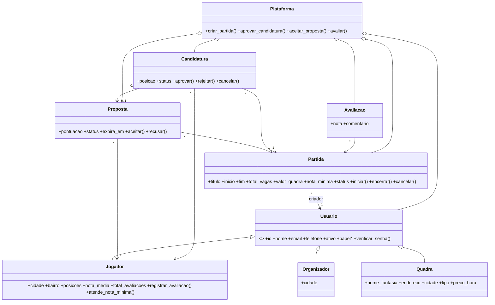

# Documentação técnica — Futsal Match

## Objetivo
Demonstrar POO com um sistema de matchmaking de jogadores de futsal. Mesmo padrão do projeto
original: classes de domínio em módulos planos, camada de entrada/saída separada (Flask) e dados em memória.

## Diagrama de classes

## Regras de negócio
**Cadastro e acesso.** E-mail único e em minúsculas; senha de no mínimo 8 caracteres (scrypt); papel imutável;
access token de 15 min; refresh de 7 dias, rotativo; logout invalida o refresh.

**Partida.** Só organizador ou quadra criam; início no futuro, fim depois do início, duração até 4 h; de 2 a 30 vagas;
a soma das posições pedidas não passa das vagas. Quadra usa o endereço do próprio cadastro. Só o criador edita
(apenas com a partida ABERTA, sem baixar as vagas abaixo das aprovadas) e muda o estado:

| De | Para | Como |
|---|---|---|
| ABERTA | COMPLETA | automática, ao aprovar a última vaga |
| COMPLETA | ABERTA | automática, se um aprovado cancelar |
| ABERTA ou COMPLETA | EM_ANDAMENTO | criador, a partir do horário de início |
| EM_ANDAMENTO | ENCERRADA | criador |
| ABERTA ou COMPLETA | CANCELADA | criador; propostas abertas expiram e candidaturas ativas são canceladas |

**Candidatura.** Uma por jogador e partida; só em partida ABERTA; respeita a nota mínima (jogador com menos de 3
avaliações não é barrado); não pode haver outra candidatura aprovada em horário sobreposto. A aprovação conta as vagas
dentro de um lock; passando do limite retorna 409.

**Proposta.** Gerada só pelo matchmaking. Expira quando o horário de início passa ou a partida deixa de estar ABERTA
(verificado ao ler e ao responder). Aceitar cria uma candidatura PENDENTE vinculada; se a candidatura violar uma regra,
a proposta não muda.

**Avaliação.** Só com a partida ENCERRADA; avaliador é o criador ou jogador aprovado; avaliado é jogador aprovado;
sem autoavaliação, uma por trio (partida, avaliador, avaliado); não pode ser editada nem removida.

**Matchmaking** (`matchmaking.py`, função `pontuar` pura): elegível quem está ativo, na mesma cidade, atende a nota
mínima, tem ao menos uma posição pedida (se houver), não tem proposta nem candidatura na partida e não tem aprovação
sobreposta. Pontuação de 0 a 100:

| Critério | Pontos |
|---|---|
| Posição principal bate com uma pedida | 40 (secundária: 20; partida sem posições definidas: 20 para todos) |
| Mesmo bairro | 20 |
| Nota média | `nota / 5 × 30` (menos de 3 avaliações: 15 fixos) |
| Histórico | 2 por partida encerrada com candidatura aprovada, máximo 10 |

Gera propostas para os melhores, até `3 × vagas restantes`, no máximo 30 por execução.

## Endpoints (`/api`)
Erros seguem `{ "codigo", "mensagem", "erro", "detalhes", "traceId" }` com 400, 401, 403, 404, 409, 422 (429 no limite de tentativas de auth).
Listagens aceitam `page`, `limit` (máx. 50) e `sort=campo:asc|desc` e respondem `{ "dados": [], "meta": { page, limit, total } }`.

| Método | Rota | Quem |
|---|---|---|
| GET | `/health` | público |
| POST | `/auth/cadastro/{jogador,organizador,quadra}`, `/auth/login`, `/auth/refresh` | público |
| POST | `/auth/logout` | autenticado |
| GET, PATCH | `/usuarios/eu` | autenticado |
| GET | `/jogadores` (cidade, bairro, posicao, notaMinima) | organizador, quadra |
| GET | `/jogadores/:id`, `/jogadores/:id/avaliacoes` | autenticado |
| PATCH, PUT | `/jogadores/eu`, `/jogadores/eu/foto` | jogador |
| PATCH | `/organizadores/eu`, `/quadras/eu` | organizador, quadra |
| GET | `/quadras` (cidade, bairro, tipo), `/quadras/:id` | autenticado |
| POST | `/partidas` (cria e dispara o matchmaking) | organizador, quadra |
| GET | `/partidas` (cidade, bairro, dataDe, dataAte, posicao, valorMaximo, status), `/partidas/minhas`, `/partidas/:id`, `/partidas/:id/participantes` | autenticado |
| PATCH, POST | `/partidas/:id`, `…/inicio`, `…/encerramento`, `…/cancelamento`, `…/matchmaking` | criador |
| GET | `/partidas/:id/candidaturas` | criador |
| POST | `/partidas/:id/candidaturas` | jogador |
| GET | `/propostas`, `/candidaturas` | jogador |
| POST | `/propostas/:id/{visualizacao,aceite,recusa}`, `/candidaturas/:id/cancelamento` | jogador dono |
| POST | `/candidaturas/:id/{aprovacao,rejeicao}` | criador da partida |
| POST, GET | `/partidas/:id/avaliacoes`, `/partidas/:id/avaliacoes/pendentes` | participante ou criador |

## Registro de decisões
- **Stack** (pedido do autor): o projeto segue o repositório base em Python/Flask com dados em memória, em vez do
  NestJS/React/PostgreSQL do documento de requisitos. Ficaram de fora Kysely, migrations, JWT assinado, argon2,
  Swagger, husky/commitlint e GitHub Actions; só a versão web foi construída (sem terminal nem Streamlit).
- **Tokens**: tokens opacos guardados em memória, com as mesmas validades do requisito (15 min / 7 dias).
- **Senha**: scrypt da biblioteca padrão, no lugar de argon2.
- **Concorrência**: um `RLock` na `Plataforma` faz o papel do `select … for update` da aprovação.
- **Rotas**: prefixo `/api` (como no projeto original), sem `/v1`. O erro inclui `erro`, igual ao original, além do `codigo`.
- **Candidatura única**: o par (partida, jogador) é único, então quem cancelou ou foi rejeitado não se candidata de novo à mesma partida.
- **Filtro de posição** em `/partidas`: devolve só as partidas que pedem aquela posição.
- **Erros de domínio** ficaram em `erros.py` (no original, `DadosInvalidosError` morava em `veiculo.py`).

## Limitações
Dados perdidos ao reiniciar; sem cobertura de testes medida (a ferramenta `coverage` não pôde ser instalada no ambiente de desenvolvimento);
validação de entrada manual nas classes de domínio; sem documentação OpenAPI.
